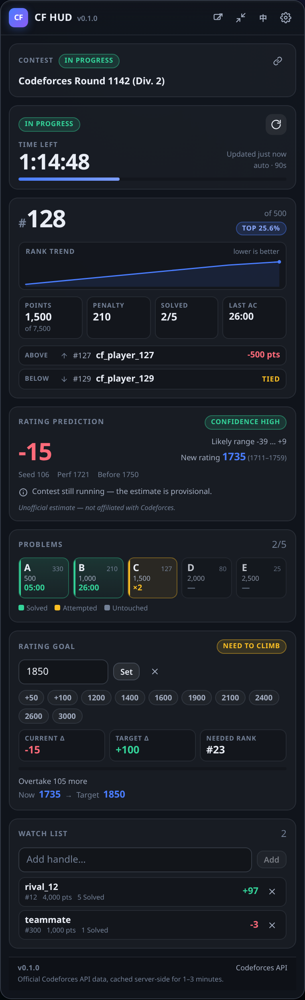

# CF HUD

A cross-platform floating HUD for Codeforces contests: live rank, score, problem status and a rating prediction, in a ~380 px window that stays on top of your IDE.

[](https://github.com/Terminal-P/cf-hud/actions/workflows/ci.yml)
[](LICENSE)
[](#install-and-run)
[](CONTRIBUTING.md)



## Features

### During the contest

- **Handle binding** — enter your Codeforces handle once. Public data only: no login, no API key, no OAuth.
- **Contest discovery** — the HUD detects the round that is running and counts down to the next one. When several rounds run at once (for example Div. 1 and Div. 2 of a combined round), it lets you pick the one you are in instead of guessing.
- **Rank card** — rank, number of participants, top percentile, points, penalty, solved count, the gaps to the rows directly above and below you, and a rank sparkline.
- **Score & penalty details** — the numbers behind the rank card, itemised.
- **Problem matrix** — for each problem: solved, attempts, or untouched; its point value; your solve time; and how many participants solved it.
- **Time & status** — countdown, contest progress, frozen-standings badge, data freshness, and the current phase (before / coding / system test / finished).
- **Rating prediction** — expected rating change from the official formula, a prediction interval, a confidence level, and the rank needed for a given gain. Always labelled as unofficial.
- **Goal planning** — set a target rating and see the rank it requires, how many places you still need to climb ("catch N more people"), and whether you are on track, need to climb, or cannot get there from your current position.
- **Watch list** — keep friends and rivals in the same panel; no API key needed.
- **Notifications** — when you are overtaken, when you lose your goal, and 15 / 5 minutes before the end — an in-app toast, plus an OS notification on desktop.
- **Refresh strategy** — ~90 s polling, manual refresh, exponential backoff on errors, and stale data kept on screen with its age instead of being replaced by a spinner.

### After the contest

- **Settlement** — once Codeforces publishes the official rating changes, the HUD compares them with the prediction it showed and displays the real delta.
- **Rating history** — a chart of your rating over time, refreshed after the rating is updated.
- **Rating published notification** — a toast and an OS notification when your new rating is out.

### Virtual participation

- **Replay a finished round** — virtual participants are not part of the official standings payload, so the HUD rebuilds your score from your own submissions, inserts it into the official ranklist, and shows your virtual rank, score, gaps and per-problem state.
- **Virtual clock** — start the timer when you begin the round on Codeforces. Optionally enter the start time shown on the site to align it immediately (useful before your first submission, or to backfill a finished VP); the first submission then corrects it automatically. Polling speeds up to every 30 seconds while the clock runs.
- **Virtual performance** — the same seed model, using the contest's pre-contest ratings, answers "what would this have been worth?". It is clearly labelled hypothetical, because virtual rounds do not change your rating.
- **Auto-resume** — reload the app or restart the desktop build and an active virtual round is picked up again from its stored session.
- **Round browser** — when no official round is running, the HUD lists recent finished rounds and lazy-loads more as you scroll (up to the 200 most recent), so older rounds are easy to replay.

### Desktop & UI

- **Floating window** — always-on-top toggle, frameless and draggable, position and size remembered by the OS, and a mini mode with rank, performance, predicted delta and timer — plus the same problem card as the full layout.
- **Global shortcut** — Ctrl+Shift+H, so you can toggle the overlay from anywhere on desktop without switching windows.
- **Browser pop-out** — in the browser the HUD is a normal page; Document Picture-in-Picture pops it into a small always-on-top window next to your editor.
- **Themes & language** — dark and light themes, adjustable opacity, and an English or Simplified Chinese interface.
- **Cross-platform** — Windows, macOS and Linux desktop apps plus the web app, all from one codebase.

## Install and run

### Prerequisites

- Node.js 20 or newer and npm.
- For the desktop app only: a stable Rust toolchain and the Tauri 2 platform prerequisites — WebView2 on Windows, Xcode command line tools on macOS, and WebKitGTK plus the usual build dependencies on Linux.

### Web app

```bash
git clone https://github.com/Terminal-P/cf-hud.git
cd cf-hud
npm install
npm run dev
```

Open <http://127.0.0.1:1420>. The page runs in any current desktop browser; Document Picture-in-Picture needs a Chromium-based browser that implements it (current Chrome and Edge do).

Production build:

```bash
npm run build     # typecheck + production build into dist/
npm run preview   # serve the build at http://127.0.0.1:4173
```

### Desktop app

```bash
npm run tauri dev     # desktop window against the dev server
npm run tauri build   # platform installer/bundle
```

The first desktop run compiles the Rust shell, which takes a few minutes. Current release builds are not code-signed, so the OS may show a security warning on first launch.

#### Windows installer

On Windows, `npm run tauri build` produces a per-user NSIS `.exe` (no admin rights required) and an `.msi` under `src-tauri/target/release/bundle/`. The repository also ships `scripts/build-windows.ps1`, which checks prerequisites, builds both bundles and prints their paths. Without a Windows machine, push the repo to GitHub and run the **Windows installer** workflow (Actions → Windows installer → Run workflow); it uploads both installers as the `cf-hud-windows` artifact. Full prerequisites, output paths and signing notes: [docs/BUILD-WINDOWS.md](docs/BUILD-WINDOWS.md).

### Other commands

| Command | What it does |
| --- | --- |
| `npm test` | Run the Vitest suite (50+ tests, including virtual-participation scoring and store integration). |
| `npm run typecheck` | TypeScript check only. |
| `npm run calibrate` | Compare predictions with official rating changes on recent contests. Hits the live API. |

### Project layout

```
src/core/     Codeforces API client, standings parser, contest logic, rating math, virtual participation
src/data/     Settings (localStorage) and IndexedDB caches
src/app/      Session store, polling, and the React store hook
src/ui/       React components and styles
scripts/      calibrate.ts — prediction accuracy harness
tests/        Vitest suites
src-tauri/    Tauri 2 desktop shell
.github/      CI workflows
```

## Data sources & API etiquette

- Only public, anonymous Codeforces API endpoints are used. No API key, no login.
- The API allows one request every two seconds; the app serialises requests through a single rate-limited queue and does not poll faster than the data changes.
- Standings are polled about every 90 seconds, because the server caches them for 1–3 minutes.
- Since 2026, `contest.standings` for regular rounds only works as an anonymous GET with exactly one parameter (`contestId`) and returns the full standings — several megabytes, server-cached. CF HUD parses that payload locally and keeps only the small derived model.
- Participant ratings for the prediction come from `user.ratedList` once per contest and are cached in IndexedDB for 12 hours, so repeat traffic is avoided.
- Virtual rounds cannot be read from the standings endpoint, so their score is rebuilt from `contest.status?contestId=…&handle=…` (a small response, polled every 30 s while the virtual clock runs). Their performance estimate seeds against the contest's pre-contest ratings from `contest.ratingChanges`, cached for 12 hours.
- No scraping, no automation, no submission automation, and never other people's source code. The HUD only shows what the public standings already show.
- Respect the API terms: do not hammer the API, do not build a proxy that multiplies requests, and increase the polling interval (poll less often) if you run multiple instances.

See [docs/ARCHITECTURE.md](docs/ARCHITECTURE.md) for the data flow and the cache layers.

## Privacy

- Everything is computed on your machine. Settings live in `localStorage`; cached data and rank history live in IndexedDB.
- The only network requests are to `codeforces.com` for the public API.

## Contributing

Contributions are welcome. Read [CONTRIBUTING.md](CONTRIBUTING.md) for the development setup, style rules, test expectations and PR checklist. Bug reports and feature proposals are just as useful as code.

## License

[MIT](LICENSE) © 2026 CF HUD contributors.

## Acknowledgements

- [Codeforces](https://codeforces.com) and its [public API](https://codeforces.com/apiHelp), used within its terms.
- [CF-Predictor](https://codeforces.com/blog/entry/50411) and [Carrot](https://github.com/meooow25/carrot) — prior art for rating prediction in the Codeforces ecosystem.
- [MikeMirzayanov's "Open Codeforces Rating System"](https://codeforces.com/blog/entry/20762) — the formula this project implements.
- Built with [React](https://react.dev), [Vite](https://vite.dev) and [Tauri](https://tauri.app).
- DeepSeek Harness.