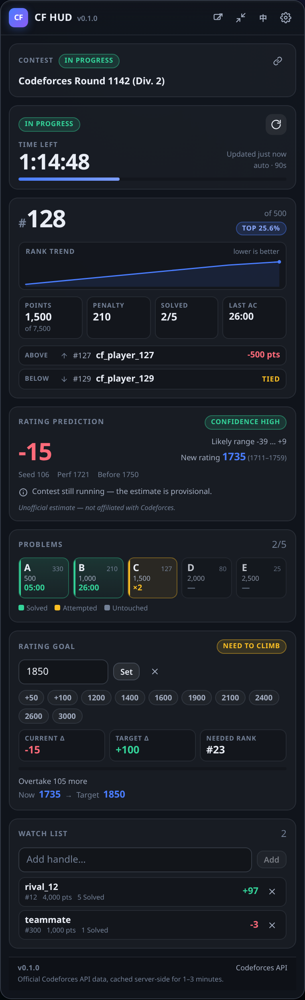

# CF HUD

一个跨平台的 Codeforces 比赛悬浮 HUD：实时排名、分数、题目状态和等级分预测，尽在一个约 380 px 宽、常驻 IDE 上方的置顶小窗里。

[](https://github.com/Terminal-P/cf-hud/actions/workflows/ci.yml)
[](LICENSE)
[](#安装与运行)
[](CONTRIBUTING.md)

## 为什么做它

在一场 rated 比赛中，你会在题面、编辑器和榜单之间来回切换几十次。每打开一次 codeforces.com 都是一次注意力中断，如果只有一块屏幕，还要搭上整个画面。CF HUD 想做的，就是这两个小时里的“第二块屏”：一个窄小的置顶面板，随时回答比赛中最常问的几个问题——我现在第几名、拿了多少分、还剩多少时间、按目前名次大概会涨多少分或者掉多少分。



## 功能

### 比赛中

- **绑定 Handle**——输入一次 Codeforces handle 即可。只使用公开数据：无需登录、无需 API key、无需 OAuth。
- **比赛发现**——自动识别正在进行的比赛，并显示下一场的倒计时。同时有多场比赛时（例如组合赛的 Div. 1 和 Div. 2），会让你选择自己参加的那一场，而不是替你猜。
- **排名卡**——名次、参赛人数、百分位、分数、罚时、通过题数、与前后两名的差距，以及名次迷你走势图。
- **分数与罚时明细**——排名卡背后那些数字的逐项拆解。
- **题目状态矩阵**——每道题的状态：已通过 / 有尝试 / 未触碰，以及分值、你的通过用时和全场通过人数。
- **时间与状态**——倒计时、比赛进度、封榜标识、数据新鲜度，以及当前阶段（赛前 / 进行中 / 等待系统测试 / 系统测试 / 已结束）。
- **等级分预测**——按官方公式估算的涨跌分、预测区间、置信度，以及“想达到某个涨幅需要多少名”。所有预测都明确标注为非官方。
- **目标规划**——设定目标 rating，查看所需名次、“还要超过多少人”，以及当前是稳了、需要往上冲，还是已经够不到。
- **关注列表**——把朋友或对手放进同一个面板，不需要 API key。
- **提醒**——被反超、目标落空、剩余 15 / 5 分钟时提醒；应用内 toast，桌面端还会有系统通知。
- **刷新策略**——约 90 秒轮询一次，支持手动刷新，出错时指数退避；刷新失败时保留上一份数据并显示其时间，而不是让界面变成加载中。

### 比赛后

- **赛后结算**——Codeforces 公布官方 rating 变化后，把真实涨跌分与比赛期间显示过的预测做对比并展示。
- **Rating 历史**——你的 rating 走势图，在 rating 更新后刷新。
- **Rating 公布提醒**——新 rating 出炉时弹出 toast 和系统通知。

### 虚拟参赛（VP）

- **回放已结束的比赛**——虚拟参赛者不在官方榜单数据里，所以 HUD 会用你自己的提交重新计分，再插入官方榜单，显示虚拟名次、分数、与前后名次的差距以及每题状态。
- **虚拟计时**——在 Codeforces 上开始虚拟参赛后启动计时。可以顺手填写官网显示的开始时间立即对齐（首次提交前很有用，也能补录已经结束的 VP）；首次提交后会自动校正。计时进行中轮询提速到 30 秒一次。
- **虚拟表现分**——同一套 seed 模型，用该场比赛赛前的 rating 数据回答“这一场大概能打多少分”。明确标注为假设值，因为虚拟参赛不改变 rating。
- **自动恢复**——刷新页面或重启桌面端后，进行中的虚拟参赛会从已保存的会话里自动恢复。
- **比赛浏览器**——没有进行中的官方比赛时，会列出最近的已结束比赛，向下滚动自动加载更多（最多最近 200 场），回放旧比赛很方便。

### 桌面与界面

- **悬浮窗**——置顶开关、无边框可拖动，位置和尺寸由系统记住；迷你模式显示排名、表现分、预测涨跌和倒计时，并保留与完整模式相同的题目卡片。
- **全局快捷键**——桌面端随时按 Ctrl+Shift+H，不用切换窗口就能控制悬浮窗。
- **浏览器画中画**——在浏览器里它就是一个普通页面；通过 Document Picture-in-Picture 可以弹成一个小置顶窗，和编辑器并排。
- **主题与语言**——深色 / 浅色主题、可调透明度、英文 / 简体中文界面。
- **跨平台**——Windows、macOS、Linux 桌面端加网页版，共用同一套代码。

## 安装与运行

### 环境要求

- Node.js 20 或更高版本，以及 npm。
- 仅桌面端需要：稳定版 Rust 工具链，以及 Tauri 2 的平台依赖——Windows 上的 WebView2、macOS 上的 Xcode Command Line Tools、Linux 上的 WebKitGTK 和常见构建工具。

### 网页版

```bash
git clone https://github.com/Terminal-P/cf-hud.git
cd cf-hud
npm install
npm run dev
```

打开 <http://127.0.0.1:1420>。页面可在当前主流桌面浏览器中运行；Document Picture-in-Picture 需要支持该特性的 Chromium 内核浏览器（当前的 Chrome 和 Edge 均支持）。

生产构建：

```bash
npm run build     # 类型检查 + 生产构建，输出到 dist/
npm run preview   # 在 http://127.0.0.1:4173 预览构建结果
```

### 桌面端


```bash
npm run tauri dev     # 对着开发服务器启动桌面窗口
npm run tauri build   # 打包平台安装程序
```

首次运行桌面端需要编译 Rust 外壳，会多花几分钟。当前的发布版本尚未代码签名，首次启动时系统可能会给出安全提示。

#### Windows 安装包

在 Windows 上执行 `npm run tauri build` 会生成免管理员的 NSIS `.exe` 安装包和 `.msi`，位于 `src-tauri/target/release/bundle/`。仓库还带了 `scripts/build-windows.ps1`，会自动检查环境、构建两种安装包并打印路径。没有 Windows 电脑的话，把仓库推到 GitHub，在 Actions 里运行 **Windows installer** 工作流（Run workflow），即可下载 `cf-hud-windows` 产物（内含两种安装包）。完整的环境要求、产物路径和签名说明见 [docs/BUILD-WINDOWS.md](docs/BUILD-WINDOWS.md)。

### 其他命令

| 命令 | 作用 |
| --- | --- |
| `npm test` | 运行 Vitest 测试（50+ 个用例，包含虚拟参赛计分与 store 集成测试）。 |
| `npm run typecheck` | 只做 TypeScript 类型检查。 |
| `npm run calibrate` | 用真实比赛对比预测值与官方 rating 变化，会访问线上 API。 |

### 仓库结构

```
src/core/     Codeforces API 客户端、榜单解析、比赛逻辑、rating 计算、虚拟参赛
src/data/     设置（localStorage）与 IndexedDB 缓存
src/app/      会话 store、轮询与 React hook
src/ui/       React 组件与样式
scripts/      calibrate.ts——预测精度校准脚本
tests/        Vitest 测试
src-tauri/    Tauri 2 桌面外壳
.github/      CI 工作流
```

## 数据来源与 API 使用规范

- 只使用 Codeforces 的公开匿名 API，不需要 API key，也不需要登录。
- 官方限制为每 2 秒最多 1 次请求；应用通过单一限速队列串行发送请求，不会比数据本身更新得更快。
- 榜单大约每 90 秒轮询一次，因为服务端会缓存 1–3 分钟。
- 2026 年起，常规比赛的 `contest.standings` 只接受匿名 GET、且只能带一个参数（`contestId`），返回的是完整榜单——几 MB，且由服务端缓存。CF HUD 在本地解析这份数据，只保留小的派生模型。
- 预测所需的选手 rating 来自 `user.ratedList`，每场比赛只取一次，并在 IndexedDB 中缓存 12 小时，避免重复流量。
- 虚拟参赛无法从榜单接口读取，因此分数由 `contest.status?contestId=…&handle=…`（响应很小，虚拟计时期间每 30 秒轮询一次）重建；虚拟表现分的种子使用 `contest.ratingChanges` 中该场比赛赛前的 rating，缓存 12 小时。
- 不做网页抓取、不做自动化、不做自动提交，也永远不展示他人的源代码。HUD 只呈现公开榜单本来就有的信息。
- 请遵守 API 条款：不要高频请求，不要搭建放大请求量的代理，同时开多个实例时请调低轮询频率（也就是拉长轮询间隔）。

数据流与缓存分层见 [docs/ARCHITECTURE.md](docs/ARCHITECTURE.md)。

## 隐私

- 所有计算都在本机完成。设置保存在 `localStorage`，缓存数据和名次历史保存在 IndexedDB。
- 唯一的网络请求是发往 `codeforces.com` 的公开 API。

## 参与贡献

欢迎贡献。开发环境、代码风格、测试要求和 PR 清单见 [CONTRIBUTING.md](CONTRIBUTING.md)。提 issue 反馈 bug 或提功能建议，和写代码同样有价值。

## 许可证

[MIT](LICENSE) © 2026 CF HUD contributors。

## 致谢

- [Codeforces](https://codeforces.com) 及其[公开 API](https://codeforces.com/apiHelp)，本项目在条款允许的范围内使用。
- [CF-Predictor](https://codeforces.com/blog/entry/50411) 与 [Carrot](https://github.com/meooow25/carrot)——Codeforces 生态中 rating 预测的先驱。
- [MikeMirzayanov 的 "Open Codeforces Rating System"](https://codeforces.com/blog/entry/20762)——本项目实现的公式来源。
- 基于 [React](https://react.dev)、[Vite](https://vite.dev) 和 [Tauri](https://tauri.app) 构建。
- DeepSeek Harness.
